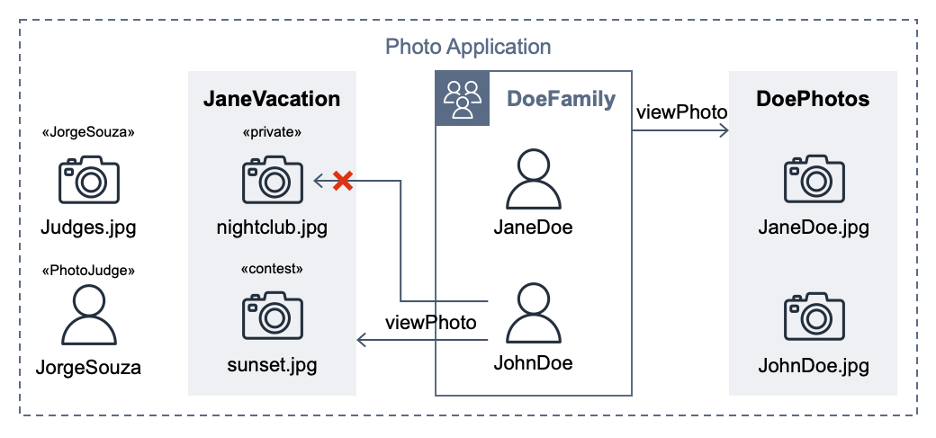

# SEC402 | Code talk | Designing complex authorization systems with Cedar

This repository contains supporting code samples for SEC402, presented at AWS Summit Washington, DC (10 June 2025 - 11 June 2025). For best results, clone and open in Visual Studio Code and install the recommended extensions found in `.vscode\extensions.json`.

> Cedar is a language for writing authorization policies and making authorization decisions based on those policies. Using Cedar, you can decouple your business logic from the authorization logic.

- [Cedar docs](https://docs.cedarpolicy.com/)
- [Cedar Playground](https://www.cedarpolicy.com/en/playground)
- [Cedar CLI](https://crates.io/crates/cedar-policy-cli) (`cargo install cedar-policy-cli@4.13.0`)
- [Cedar policy language for Visual Studio Code](https://marketplace.visualstudio.com/items?itemName=cedar-policy.vscode-cedar)

## PhotoApp

It reuses the hypothetical photo sharing application model from the [Cedar policy language in action](https://catalog.workshops.aws/cedar-policy-language-in-action) workshop. By using that app, users organize their photos into albums and share them with groups of users. Figure 1 shows the entities from the photo application.

_Figure 1: Photo Application entities_

## Requirements

Requirements matching the above diagram from the [Full PhotoApp Example](https://catalog.workshops.aws/cedar-policy-language-in-action/en-US/20-tutorial/26-fullexample) of [Cedar policy language in action](https://catalog.workshops.aws/cedar-policy-language-in-action) workshop.

1. All entities are in the **PhotoApp** namespace
1. All photos are in the **Application PhotoApp**
1. **User JaneDoe** and **User JohnDoe** are in **UserGroup DoeFamily**
1. **UserGroup DoeFamily** has view access to **Album DoePhotos**
1. **User JaneDoe** owns **Photo JaneDoe.jpg** in **Album DoePhotos**
1. **User JohnDoe** owns **Photo JohnDoe.jpg** in **Album DoePhotos**
1. Everyone has view, edit, and delete access to any Photo where they are the owner
1. No one but the owner has access to Photos whose labels include the string "private"
1. **User JohnDoe** has view access to **Album JaneVacation**
1. **User JaneDoe** owns **Photo nightclub.jpg** in **Album JaneVacation**
1. The labels for **Photo nightclub.jpg** include the string "private"
1. **User JaneDoe** owns **Photo sunset.jpg** in **Album JaneVacation**
1. The labels for **Photo sunset.jpg** include the string "contest"
1. **User JorgeSouza** has Role PhotoJudge
1. **Role PhotoJudge** has view access to Photos whose labels include the string "contest" when in a judgingSession context
1. A User has view access to Photos whose optional subjects include their User entity
1. The subjects for **Photo Judges.jpg** include the entity **User JorgeSouza**
1. **User JohnDoe** owns **Photo Judges.jpg**

## Stories

Stories are from [Cedar policy validation pipeline](https://github.com/aws-samples/cedar-policy-validation-pipeline/blob/main/policystore/tests/README.md) and defined using **Given** [initial context], **When** [event occurs], **Then** [ensure some outcomes] language and [Specification by example](https://en.wikipedia.org/wiki/Specification_by_example).

### Album DoePhotos

**Title:** UserGroup DoeFamily has view access to Album DoePhotos

**Given** a `User` in a `UserGroup` \
 **And** a `Photo` in an `Album` \
**When** `Action` viewPhoto is attempted \
 **And** the `Album` permits the `UserGroup`\
**Then** the result should be

Examples:

| result | User       | UserGroup | Photo       | Album     |
| ------ | ---------- | --------- | ----------- | --------- |
| ALLOW  | JohnDoe    | DoeFamily | JaneDoe.jpg | DoePhotos |
| ALLOW  | JaneDoe    | DoeFamily | JohnDoe.jpg | DoePhotos |
| DENY   | JorgeSouza |           | JaneDoe.jpg | DoePhotos |

### Photo owner

**Title:** Everyone has view, edit, and delete access to any Photo where they are the owner

**Given** a `User` \
 **And** a `Photo` with an owner \
**When** `Action` viewPhoto, editPhoto, or deletePhoto is attempted \
**Then** the result should be

Examples:

| result | User    | Action      | Photo       | owner   |
| ------ | ------- | ----------- | ----------- | ------- |
| ALLOW  | JaneDoe | viewPhoto   | JaneDoe.jpg | JaneDoe |
| ALLOW  | JaneDoe | editPhoto   | JaneDoe.jpg | JaneDoe |
| ALLOW  | JaneDoe | deletePhoto | JaneDoe.jpg | JaneDoe |
| ALLOW  | JohnDoe | viewPhoto   | JohnDoe.jpg | JohnDoe |
| DENY   | JohnDoe | editPhoto   | JaneDoe.jpg | JaneDoe |
| DENY   | JohnDoe | deletePhoto | JaneDoe.jpg | JaneDoe |

### Album JaneVacation

**Title:** User JohnDoe has view access to Album JaneVacation, but no one but the owner has access to Photos whose labels include the string "private"

**Given** `User` JohnDoe \
 **And** a `Photo` in `Album` JaneVacation \
**When** `Action` viewPhoto is attempted \
 **And** the `Album` permits `User` JohnDoe \
**Then** the result should be

Examples:

| result | User    | Photo         | Album        | owner   | labels  |
| ------ | ------- | ------------- | ------------ | ------- | ------- |
| ALLOW  | JaneDoe | nightclub.jpg | JaneVacation | JaneDoe | private |
| ALLOW  | JaneDoe | sunset.jpg    | JaneVacation | JaneDoe |         |
| ALLOW  | JohnDoe | sunset.jpg    | JaneVacation | JaneDoe |         |
| DENY   | JohnDoe | nightclub.jpg | JaneVacation | JaneDoe | private |

### Role PhotoJudge

**Title:** Role PhotoJudge has view access to Photos whose labels include the string "contest" **When** in a judgingSession context

**Given** a `User` in a `Role` PhotoJudge \
 **And** a `Photo`'s labels include the string "contest" \
**When** `Action` viewPhoto is attempted \
 **And** in a judgingSession context \
**Then** the result should be

Examples:

| result | User       | judgingSession | Photo      | labels  |
| ------ | ---------- | -------------- | ---------- | ------- |
| ALLOW  | JorgeSouza | true           | sunset.jpg | contest |
| DENY   | JorgeSouza | false          | sunset.jpg | contest |

### User JorgeSouza

**Title:** A User has view access to Photos whose optional subjects include their User entity

**Given** a `User` \
 **And** a `Photo`'s subjects include their User entity \
**When** `Action` viewPhoto is attempted \
**Then** the result should be

Examples:

| result | User       | Photo         | subjects   |
| ------ | ---------- | ------------- | ---------- |
| ALLOW  | JorgeSouza | Judges.jpg    | JorgeSouza |
| DENY   | JorgeSouza | nightclub.jpg |            |
| DENY   | JorgeSouza | sunset.jpg    |            |

## License

This library is licensed under the MIT-0 License. See the LICENSE file.
